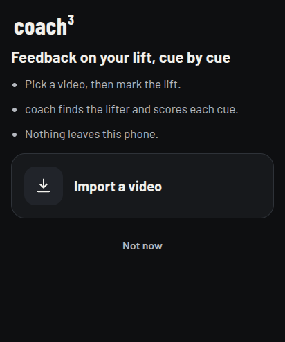
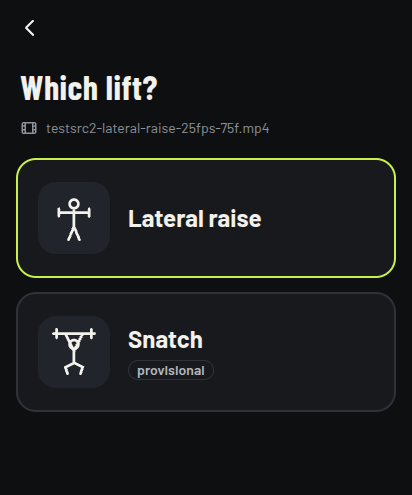
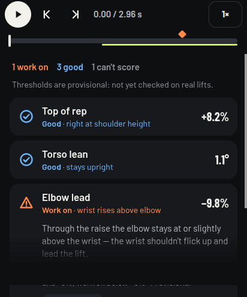
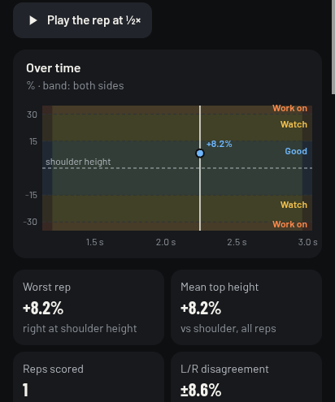

<p align="center">
  
</p>

# Coach Cubed

Technique feedback on your lifts, cue by cue, on your phone. Pick a video of
a lift and mark where it starts and ends. Coach Cubed finds your joints in
every frame and checks each cue: the back angle in the first pull, triple
extension, how high the arms go, whether the torso stays upright, the elbows,
the tempo, left against right. It all runs on the phone. Nothing is uploaded.

**Open the app: [coach-cubed.org](https://coach-cubed.org)** · version 0.1.0 ·
[release notes](docs/release-0.1.0.md)

<p align="center">
  
  
  
  
</p>

## What it does

1. **Pick a video** of your lift from the phone.
2. **Pick the lift:** the lateral raise or the snatch.
3. **Mark the lift:** step frame by frame to where it starts and where it
   ends.
4. **Read the cues.** Each cue gets a card with its verdict (good, watch,
   work on) and its value. Open one to see the value over the whole lift and
   the moment it was worst. If the pose isn't clear enough to judge a cue,
   the card says "can't score" instead of guessing.

The thresholds are marked *provisional* until they have been checked on a set
of real lifts.

## Private and offline

There is no account, no server and no analytics. Your videos, the poses and
the results stay in the browser's storage on your phone. After the first
visit the app works in airplane mode; the pose model (MoveNet Thunder, about
17.5 MB with the rest of the app) is stored on the phone too.

## Install

Open [coach-cubed.org](https://coach-cubed.org) on your phone, then choose
**Install app** or **Add to Home screen** in the browser's menu.

It needs Chrome or another Chromium-based browser, version 108 or newer. It
was tested on a Fairphone 6 (Android 16) in Brave and in Android's WebView.
Firefox and Safari, and with them iPhones, haven't been tested yet.

## What's next

- **The gym session:** keep the camera running while you train, replay your
  last lift right after it, and mark it there. It is built but unfinished,
  so it is off in 0.1.0. To try it: Settings → "Gym session (preview)".
- **An Android app** (APK) on this repo's Releases, and later on F-Droid.
- **Checking the cues against real lifts,** so the thresholds can lose their
  "provisional" tag.
- **More lifts.** How to add a lift or a cue: [docs/lifts.md](docs/lifts.md).

## Development

The app is static files: plain ES modules, the screens in Preact with htm, no
build step for the code. The pose model runs on TensorFlow.js, built from its
sources. From the repo root, with Node.js 22:

```sh
npm --prefix app ci                       # the build's inputs
node app/tools/build-tfjs.mjs             # TF.js from source
app/tools/fetch-models.sh                 # MoveNet Thunder's weights, checksum verified
node app/tools/assemble.mjs               # builds app/dist/
node app/tools/serve.mjs --port 8090      # http://127.0.0.1:8090/
npm test                                  # all tests
```

More:

- [app/README.md](app/README.md): every command, how the app is built, and
  each screen;
- [docs/development.md](docs/development.md): the repo's layout, the older
  analysis page and the ViTPose dev server;
- [docs/README.md](docs/README.md): the index of the docs.

## Licence

Coach Cubed is free software under the
[GNU Affero General Public License v3.0 or later](LICENSE). The coach³ logo
is CC BY-SA 4.0 ([logo/](logo/README.md)). The authors are listed in
[docs/authors.md](docs/authors.md), and every third-party component, with its
licence, is in [THIRD_PARTY.md](THIRD_PARTY.md).
